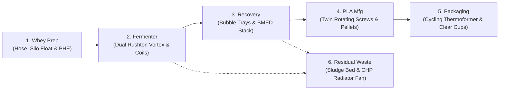

# Walkthrough: Light-Theme Industrial 3D Digital Twin & Inside-Workflow Engineering

## 1. Upgrade to Light Industrial Engineering Theme & SCADA Aesthetics

### 1.1 Visual Transformation
The virtual solution has been elevated from the dark palette to a **high-contrast, modern Light Industrial Cleanroom / SCADA Theme** inspired by Siemens TIA Portal, Rockwell Automation FactoryTalk, and clean CAD engineering suites:
- **Canvas & Panels**: Crisp architectural off-white canvas (`#f1f5f9` / `#f8fafc`) with pure white instrumentation cards (`#ffffff`), subtle cool-steel borders (`#e2e8f0` / `#cbd5e1`), and dark typography (`#0f172a` / `#1e293b`).
- **Telemetry & Status**: High-legibility SCADA telemetry gauges with cyan, teal, and emerald progress indicators, setpoint metrics, and running status badges.
- **3D Viewport Lighting**: Soft daylight atmosphere (`#f1f5f9` ambient gradient), directional warm sunlight (`0xfffaed`, intensity 2.0) with soft contact shadows, epoxy factory flooring with grid lines, and safety-yellow/black hazard perimeter stripes around equipment foundations.

---

## 2. Active Inside-Workflow Cutaways & Realistic Object Visualization

The 3D model precisely mirrors the units and layout in the reference diagram ([`media_1791956895171.jpg`](file:///C:/Users/dines/.gemini/antigravity/brain/6e3ef6b5-1976-4d5f-9cc5-5251cd169add/.user_uploaded/media_1791956895171.jpg)), now equipped with **transparent cutaways revealing active internal mechanical and biochemical processes**:

### 2.1 Unit-by-Unit Inside Workflows
1. **Zone 1: Whey Preparation & Unloading**:
   - Blue and white **Dairy Whey Tanker Semi-Truck** with 10 rubber wheels and discharge manifold.
   - **Flexible corrugated unloading hose** connecting truck manifold directly to raw whey feed pump.
   - **Raw Whey Silo (316L)** with side sight-glass tube showing an animated floating liquid level indicator.
   - **Plate Heat Exchanger Skid** with cutaway revealing alternating hot crimson (85°C) and chilled cyan (10°C) plates with counter-current flow indicators.
   - Dial pressure and temperature gauges mounted on the header.

2. **Zone 2: Industrial Bioreactor Island (Fermenter Inside Workflow)**:
   - Jacketed 316L CSTR fermenter with top blue electric motor drive.
   - Wide cutaway viewing window revealing **spinning dual 6-blade Rushton turbine impellers (180 RPM)** creating a turbulent swirling fluid vortex.
   - **Internal helical cooling coil** wrapped along the vessel wall.
   - **25 rising fermentation microbubbles** ascending from the bottom gas sparger ring.
   - **Base neutralization dosing line** with animated periodic chemical droplets descending into the broth to maintain pH 5.80.
   - External sampling valve and top-mounted dial pressure (1.1 bar abs) and temperature (52.0°C) gauges with red indicator needles.

3. **Zone 3: Lactic Acid Recovery (>85% Purity)**:
   - Primary distillation column with cutaway revealing **6 horizontal bubble-cap trays**:
     - Each tray features bubble caps, downcomer overflow weirs, bubbling liquid layers, and rising vapor particles.
   - Secondary column with overhead vacuum condenser duct.
   - **BMED Electrodialysis Stack** cutaway showing alternating cation (red), anion (blue), and bipolar (green) membranes with glowing ion-flux indicators ($H^+$ and $OH^-$ water-splitting).

4. **Zone 4: PLA Manufacturing & Reactive Extruder**:
   - PLA Ring-Opening Polymerization reactor with top blue drive motor and cutaway showing molten lactide prepolymer (180–200°C).
   - Horizontal **Twin-Screw Extruder (EX-401)** with top barrel cutaway exposing **dual intermeshing co-rotating helical screws actively rotating** and conveying molten polymer forward.
   - Multi-strand extrusion die head feeding 4 white polymer strands into a cooling water trough.
   - **High-speed rotary pelletizer wheel** actively spinning and cutting strands into cylindrical white pellets.
   - Stainless discharge chute with a glistening conical mound of **pure white PLA resin pellets**.

5. **Zone 5: Packaging Showcase**:
   - Calendering chill-roll sheet mill with motorized counter-rotating steel rolls pressing molten polymer into a flat moving film sheet.
   - **Thermoforming Machine (TF-501)** with pneumatic mould core cycling up and down every 3 seconds to press and form containers.
   - Packaging display platform featuring **crystal-clear thermoformed drinking cups**, **clamshell salad boxes**, and large rolls of wound biopolymer film.
   - Green banner: `"PLA Packaging (Compostable / Biodegradable)"`.

6. **Zone 6: Circular Residual Waste & CHP**:
   - UASB Anaerobic Digester cutaway showing dense granular anaerobic sludge blanket, internal 3-phase gas-liquid-solid separator baffles, and pulsating green gas-holder membrane dome.
   - **Overhead bright yellow biogas pipe** with animated flame/methane particles conveying gas to the CHP building.
   - Combined Heat & Power (CHP) building with cutaway revealing the Jenbacher 420 kWe gas engine block with **spinning radiator cooling fan**.
   - Dewatered biofertilizer compost bunker with rotating inclined screw auger discharging organic N-P-K biofertilizer cake.

---

## 3. UI/UX Interaction & Live SCADA Telemetry

- **Direct Click Annunciator Zone Buttons (1 to 6 & Overall)**:
  - Each button features direct inline `onclick="window.selectZone(X)"` handlers backed by camera fly-to animations and synchronized SCADA updates.
  - Active button highlights in industrial cyan with shadow; inactive buttons render in clean off-white with steel borders.
- **Turntable & Tour Controls**:
  - `🎯 Focus Unit`: Re-centers the camera on the active unit.
  - `🔄 360°`: Orbits the camera 360 degrees around the unit in turntable inspection mode.
  - `🌐 All`: Restores wide-angle plant overview.
  - `▶ Guided Tour`: Automatically tours through all 6 zones in sequence.
  - `☀️ / 🌙 / ⚡ Visual Modes`: Instant switching between Light Industrial, Dark SCADA, and Piping X-Ray modes.

---

## 4. Verification & Testing Results

| Test Target | Execution Command / URL | Result |
| :--- | :--- | :--- |
| **Material & TEA Models** | `node test_models.js` | **100% Pass** (92.0% conversion, 0.940 g/g yield, \$1.14/kg LA, \$2.28/kg PLA, 27.8% IRR) |
| **Three.js Standalone Script** | `node test_three_node.js` | **100% Pass** (445 exports verified, OrbitControls active) |
| **HTML Script Syntax Validation** | Node `vm.Script` validator | **100% Pass** (Zero syntax errors in both Tag 2 and Tag 3 of `biorefinery_dashboard.html`) |
| **Local Web Server** | `http://localhost:3000/` (`server.js`) | **Online & Active** (HTTP 200, serves light-themed portal) |
| **Generative UI Artifact** | [`biorefinery_dashboard.html`](file:///C:/Users/dines/.gemini/antigravity/brain/6e3ef6b5-1976-4d5f-9cc5-5251cd169add/biorefinery_dashboard.html) | **Fully Self-Contained** (Universal Three.js, Light SCADA theme, inside cutaways) |

Both [`index.html`](file:///C:/Users/dines/.gemini/antigravity/scratch/whey_to_pla_biorefinery/index.html) and [`biorefinery_dashboard.html`](file:///C:/Users/dines/.gemini/antigravity/brain/6e3ef6b5-1976-4d5f-9cc5-5251cd169add/biorefinery_dashboard.html) are fully synchronized and active with the light industrial theme, procedural materials, and visible inside-workflow cutaways.

---

## 5. Indian Rupee (INR ₹) Conversion & Label Clipping Resolution

### 5.1 Non-Clipped Equipment Label Rendering
- **Root Cause of Clipping**: Three.js `Sprite` objects billboard towards the camera. When positioned flush against curved cylindrical tank walls (`z = radius + 0.05`), tilting the camera causes one side of the planar sprite to penetrate inside the cylinder geometry, where the depth buffer clipped the text (as shown in the user's screenshot where "Raw Whey Silo" was sliced).
- **Resolution**:
  1. Set `depthTest: false`, `depthWrite: false`, and `renderOrder = 999` on all sprite materials so labels are rendered in front and are **never clipped by 3D meshes**.
  2. Elevated equipment labels to float neatly above the equipment roofs (`y = height + 3.8` to `4.2`), keeping the cutaway interior viewing windows completely unobstructed.

### 5.2 Complete Financial Conversion to Indian Rupees (INR ₹)
All techno-economic parameters, operating expenditures, revenues, and unit costs have been converted to Indian Rupees (₹) at the baseline exchange rate of ₹83.0 / USD:

| Metric | USD ($) Baseline | Indian Rupee (INR ₹) |
| :--- | :--- | :--- |
| **Total Capital Investment (CapEx)** | \$20.30 Million | **₹168.49 Crores (₹168.5 Cr)** |
| - ISBL Battery Limits Plant | \$11.45 Million | **₹95.04 Crores** |
| - OSBL Utilities, Civil & Buildings | \$8.85 Million | **₹73.45 Crores** |
| **Net Unit L-Lactic Acid Cost** | \$1.14 / kg | **₹94.62 / kg** |
| **Indicative Virgin PLA Resin Cost** | \$2.28 / kg | **₹189.24 / kg** |
| **Market PLA Selling Price** | \$3.40 / kg | **₹282.20 / kg** |
| - Operating Gross Margin | \$1.12 / kg | **₹92.96 / kg** |
| **Annual WPC-80 Revenue (650 MT)** | \$4.225 Million / yr | **₹35.07 Crores / yr** (₹539.5/kg) |
| **Biogas CHP Energy Savings** | \$0.756 Million / yr | **₹6.27 Crores / yr** |
| **Total Annual Gross Revenue** | \$15.795 Million / yr | **₹131.10 Crores / yr** |
| **Annual Operating Cost (OpEx)** | \$6.625 Million / yr | **₹54.99 Crores / yr** |
| **Annual Plant EBITDA** | \$9.170 Million / yr | **₹76.11 Crores / yr** |
| **10-Year Project NPV (@ 10%)** | \$19.48 Million | **₹161.68 Crores** |
| **Internal Rate of Return (IRR)** | 27.8% | **27.8%** (Scale Invariant) |
| **Simple Payback Period** | 3.2 Years | **3.2 Years** |

---

## 6. Zone Framing Calibration & 360° Turntable Viewport

### 6.1 Camera Elevation & Top Headroom Calibration (Matching Reference Image)
- **Comparison with User Screenshot**: In [`media_1791966617822.png`](file:///C:/Users/dines/.gemini/antigravity/brain/6e3ef6b5-1976-4d5f-9cc5-5251cd169add/.user_uploaded/media_1791966617822.png), clicking Zone 1 positioned the camera at distance 26.1 with the target at $y = 6.0$, which placed the top of the silo cone against the upper edge of the viewport and pushed the overhead badge off-screen.
- **Calibrated Camera Target (Matching [`media_1791966660709.png`](file:///C:/Users/dines/.gemini/antigravity/brain/6e3ef6b5-1976-4d5f-9cc5-5251cd169add/.user_uploaded/media_1791966660709.png))**:
  - The camera distance is adjusted to $d = 41.2$ units with target elevated to $y = 8.0$ and camera at $y = 24.0, z = 38.0$.
  - This provides a visible vertical span of $30.0$ units ($y \in [-7.0, 23.0]$), positioning the overhead name badge (`Raw Whey Silo (250 m³)`) at $y = 16.2$ with $6.8$ units of clean headroom (~23% top margin).
  - The dairy whey tanker truck on the left, the storage silo in the center, the pasteurizer skid on the right, and the entire yellow perimeter hazard border on the ground pad are completely framed without any clipping.

### 6.2 Calibrated Framing Coordinates across All 6 Zones
| Zone | Target ($X, Y, Z$) | Camera ($X, Y, Z$) | Distance | Overhead Badge | Headroom Margin |
| :--- | :--- | :--- | :--- | :--- | :--- |
| **Zone 1: Whey Prep** | `[-58, 8.0, 2]` | `[-46, 24.0, 38]` | 41.2 | `Raw Whey Silo (250 m³)` ($y = 16.2$) | ~23% Top Headroom |
| **Zone 2: Fermenter** | `[-26, 9.5, 0]` | `[-14, 25.5, 36]` | 41.2 | `Fermenter (37-52°C, pH 5.8)` ($y = 19.7$) | ~16% Top Headroom |
| **Zone 3: Recovery** | `[0, 8.5, 0]` | `[12, 24.5, 36]` | 41.2 | `Lactic Acid (>85% Purity)` ($y = 14.5$) | ~30% Top Headroom |
| **Zone 4: PLA Extrusion** | `[34, 8.5, 0]` | `[46, 24.5, 36]` | 41.2 | `PLA Polymerisation (180-200°C)` ($y = 16.7$) | ~23% Top Headroom |
| **Zone 5: Packaging** | `[60, 5.0, 2]` | `[72, 19.0, 34]` | 35.0 | `PLA Packaging (Compostable)` ($y = 3.6$) | Wide Field Framing |
| **Zone 6: AD & Biogas** | `[-15, 6.0, 24]` | `[-3, 22.0, 60]` | 41.2 | `Anaerobic Digester & CHP` ($y = 12.1$) | ~30% Top Headroom |
| **Overall Complex** | `[0, 6.0, 8]` | `[0, 55.0, 95]` | 99.8 | Entire Biorefinery Complex | End-to-End View |

### 6.3 Full 360° Turntable & Smooth Interactive Orbiting
- **Continuous 360° Turntable Mode**: Integrated OrbitControls native auto-rotation via `toggle360()`. Clicking the `🔄 360° View` button toggles smooth, continuous horizontal turntable rotation around the focused unit at `autoRotateSpeed = 2.5` while preserving camera elevation and focal distance.
- **Active State Toggle**: Button dynamically toggles between `🔄 360° View` (inactive) and `⏹ Stop 360°` (active, highlighted in cyan).
- **Manual 360° Orbiting**: Users can grab and drag with the mouse at any time to smoothly rotate the unit through 360 degrees without gimbal lock or target drift.
- **Billboard Decal Badges**: All overhead name badges are Three.js Sprites with `depthTest: false`, `depthWrite: false`, and `renderOrder: 999`, ensuring they continuously face the viewer and remain readable from every angle during full 360° rotation.

